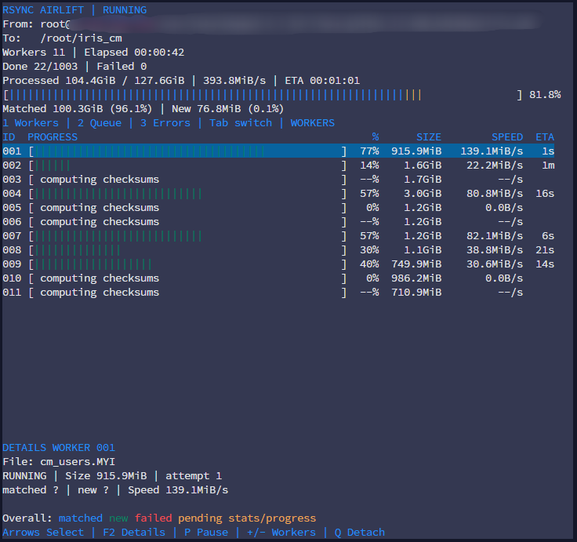
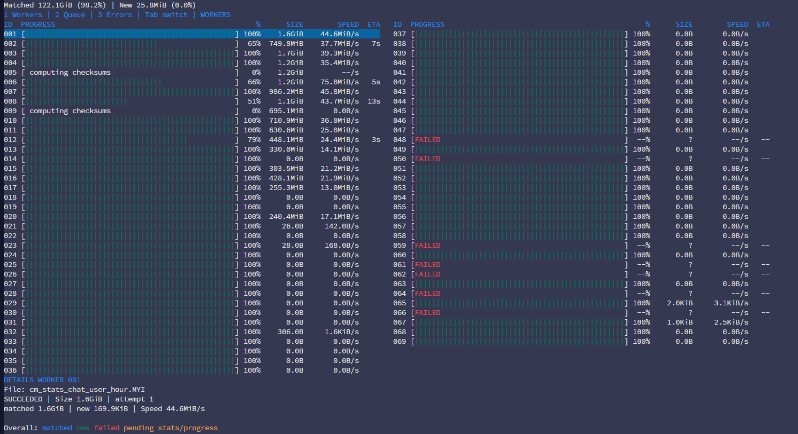

# Rsync Airlift

### The power of rsync. Multiplied.

**Rsync is brilliant. Give it a crew.**

Rsync can reconcile enormous files while transferring only the parts that changed.
That makes it an excellent tool for moving large datasets, repeating synchronization
passes, and preparing a server migration while most of the service remains online.

But a directory full of large files also contains an opportunity: independent files
can be processed at the same time. When one rsync process leaves CPU, storage, or
network capacity available, several processes can put more of that capacity to work.

Rsync Airlift coordinates that work. It runs the original rsync through a pool of
SSH ControlMaster connections, feeds files to available workers, and shows the
operation in an interactive terminal monitor inspired by `htop`.

You still choose the files, endpoints, and rsync options. Airlift manages the queue,
the workers, and the view of what is happening.

## Why Airlift?

Parallel rsync is an established approach. Airlift brings visibility, live control,
and file scheduling together in one terminal workflow.

- **See the whole operation.** An `htop`-inspired dashboard shows each worker's
  file progress, size, speed, and ETA alongside the queue and errors. Overall
  statistics distinguish matched data from newly transferred data, with elapsed
  time and an average processing rate at completion. Select a worker to inspect
  its current file and error details.
- **Adjust the run as it happens.** Increase or decrease concurrency from the
  keyboard, pause the assignment of new files while active transfers finish,
  and resume the queue when ready. Detach the monitor and attach again to the
  running dispatcher. Each attempt has a raw rsync log; after an interruption,
  rerun the command and let rsync reconcile the destination using the options
  you supplied.
- **Put available resources to work.** The CLI collects file sizes before
  transfer and schedules the largest files first. A shared queue feeds each
  available worker its next job. Small files are grouped into batches with a
  default minimum load of 5 MiB, amortizing local and remote rsync startup across
  many files. Each worker also reuses its SSH ControlMaster connection across jobs.
  This can reduce waiting on workloads with independent
  files and spare CPU, storage, or network capacity; it does not guarantee a
  speedup when those resources are already saturated.

The goal is to make parallel synchronization easy to watch and control while
keeping rsync's behavior and your choice of copy options at the center.
Each file is processed by one worker; splitting a single file across CPU cores
is not implemented. Run logs are available, but a persistent job history and
dispatcher checkpoints are not implemented either.



*Parallel synchronization in progress: per-worker progress, file sizes, speeds,
and estimated completion times. Displayed rates measure logical processing, not network throughput.*

## Born from a production migration

Airlift began with a real migration: approximately **1.16 TB of MyISAM database
files**, a changing production service, and a limited window for downtime.

The approach was to copy ahead of the move, repeat synchronization passes to reduce
the remaining differences, then stop MySQL and perform the final pass against
stable files before switching production to the destination.

The preliminary copies were only preparation. A copy of a running MyISAM database
is **not an application-consistent backup**. The final synchronization required
stopping the database so its files would stop changing.

A small Kotlin dispatcher gave multiple rsync processes their own SSH connections
and a shared queue of files. As soon as a worker finished, it took the next file.
Large files went first, reducing the chance of ending with one enormous file while
every other worker sat idle.

The migration used **16 workers**, reached **up to 900 Mbit/s on a 1 Gbit/s link**,
and finished with **12 minutes of downtime**.

That does not mean a terabyte crossed the network in twelve minutes. Most of the
data had already been copied. The downtime covered the final reconciliation and
the production switch. Reducing that last stretch of work was the point.

## A small core, a clear view

The original dispatcher did its job. The next question was how to see what all
those workers were doing without following a pile of separate logs.

That became the Airlift monitor: individual progress bars, file sizes, speeds,
estimated completion times, queue and error views, and a details panel for the
selected worker. You can change concurrency while a run is active, pause the
assignment of new files, or detach the panel and attach again later.



*A larger worker pool during an experiment: per-worker progress, visible failures,
and details for the selected worker. Columns are added when the available height fills up.*

The overall bar separates data that did not need to be sent from newly transferred
file data and failures. `Matched` includes unchanged files that rsync skipped;
it does not imply that every byte was checksum-verified. `Processed` and the
displayed speeds describe logical file processing, not measured network traffic.

The project has two Kotlin/JVM modules:

- **`core`** accepts a prepared list of files, owns the queue, and manages worker
  connections. Applications can supply their own selection and ordering.
- **`monitor`** provides the command-line launcher, file discovery, size collection,
  largest-first scheduling, an attachable monitoring service, and the Lanterna TUI.

This separation keeps the library useful beyond the migration that inspired it.
The input can be database files, archives, media, or any other list of files.
Application-specific selection belongs to the caller; Airlift handles dispatch.

## What parallelism changed in practice

In subsequent experiments on a dataset of approximately **127.6 GiB across 1,003
files**, a one-worker run took **6:34**. A six-worker run took **1:29** — an observed
**4.43× reduction in elapsed time**. Further runs included **2:09 with six workers**
and **1:35 with twelve**. Before batching, the fastest observed run finished in **1:14 with eleven
workers**, with **359.5 MiB of new file data** and **no failed files**. Compared
with the one-worker run, that is **5.32× faster**, or **81.2% less elapsed time**.

After introducing small-file batching, a run with **four workers** completed in
**1:14**, with **303.3 MiB of new file data**. A subsequent run with **eight workers**
finished in **50 seconds**, with **318.4 MiB of new file data**, all **1,003 files**
completed, and **no failures**. That is an observed **7.88× speedup** over the
original one-worker run, or **87.3% less elapsed time**.

One worker handled **458 files in a single rsync invocation**. Previously, each
file required starting rsync on both the local and remote machines and negotiating
a new rsync protocol session, even though the SSH connection was already reused.
Batching amortizes that startup and protocol overhead across the file list. Large
files still occupy their own jobs in the descending-size queue, while small files
share invocations near the end of the run.

These were practical migration experiments, not a controlled benchmark. The amount
of changed data differed between runs, and filesystem caching may have influenced
the results. They demonstrate the benefit on this workload, not a universal speedup
or a promise that adding workers always helps.

Parallelism is most useful when there are several substantial files and spare
resources to process them. If the network or storage is already saturated, more
workers may add contention. Each file is still handled by one rsync process:
Airlift does not split a single file between workers.

For a final synchronization, the useful measure is often the time between stopping
writers and bringing production back. On this workload, making independent files
progress together shortened that wait considerably.

## Built around rsync

Airlift keeps rsync responsible for its delta-transfer algorithm and file-copying
behavior. Copy options are supplied through `--rsync`; the dispatcher adds the
transport and reporting arguments it needs to manage individual jobs.

It also leaves consistency to the application. For databases, virtual machines,
and other actively changing datasets, arrange a consistent snapshot or a coordinated
shutdown before treating the result as authoritative. A successful file transfer
alone cannot establish that consistency.

The aim is straightforward: keep available workers busy, make the operation easy
to understand, and reduce the time spent waiting for synchronization to finish.

**Move terabytes. Keep downtime short.**

*Built with Kotlin. Powered by rsync. Inspired by a real production migration.*

## Build

```text
./gradlew build
./gradlew :monitor:installDist
./monitor/build/install/rsync-airlift-monitor/bin/rsync-airlift-monitor --demo
```

Building and unit tests work on Windows. Actual transfers target a POSIX environment
(Linux or WSL with a Linux JDK), with OpenSSH and rsync installed on both hosts.
Provision known_hosts before starting; host key verification is mandatory.
With `SSHPASS` present in the environment, initial SSH connections use `sshpass -e`
and `BatchMode=no` (install sshpass on the dispatcher machine). Otherwise they
use keys/ssh-agent and `BatchMode=yes`. If key authentication fails and an
interactive console is available, Airlift asks for the SSH password once, without
echo, before file discovery and opening the monitor. This fallback also requires
sshpass. The entered password is reused for discovery and worker connections;
it is not written to disk, logs, or command arguments, or exported to your shell.
A rejected password ends startup without another prompt. For a headless launch,
configure keys/ssh-agent or export `SSHPASS` in advance.
The password is supplied to sshpass through its process environment. This applies to discovery
and worker ControlMaster authentication; multiplexed operations use the existing master.

## Confirming a transfer and Midnight Commander

Before a real transfer, the launcher displays `From` and `To` and asks for
confirmation. Only `y` or `yes` starts synchronization; Enter, `no`, or EOF cancels.
Confirmation happens before SSH authentication, discovery and worker startup.
`--swing` uses a graphical confirmation dialog. Unattended runs must pass `--yes`;
this skips only the direction confirmation, not SSH host-key verification or authentication.
The core library, demo and attach modes do not ask for transfer confirmation.

Midnight Commander shell-link paths are recognized automatically:
`/sh://user@host/home/data` becomes `user@host:/home/data`.
No `--mc` flag is needed; it is accepted as an optional compatibility flag.
Paths containing spaces are retained. One endpoint must still be local; remote-to-remote
copies are not supported. Use `--port` for a nonstandard SSH port rather than embedding
a port in the MC shell-link host.

Add an entry to `~/.config/mc/menu` (adjust the absolute JAR path):

```text
A Rsync Airlift - synchronize panels
    java -jar /opt/rsync-airlift/rsync-airlift.jar --rsync "-av --partial" %d %D
```

`%d` is the **active** panel directory (source); `%D` is the **other** panel
directory (destination), not fixed left/right positions. MC expands the macros
in its user-menu command. Review the displayed paths before confirming the copy.
See the [MC manual](https://source.midnight-commander.org/man/mc.html) for user menus
and macro substitution. Airlift makes its own SSH connections; it does not reuse MC's
authenticated shell link. Its normal key, `SSHPASS`, or interactive password flow applies.

## Executable JAR bundle

```text
./gradlew :monitor:jarBundleZip
```

The regular `build` also produces
`monitor/build/distributions/rsync-airlift-0.1.0-SNAPSHOT-jar.zip`.
Extract the entire ZIP on the target machine, keeping this layout:

```text
rsync-airlift.jar
lib/
  ...runtime dependencies...
```

With Java 21 installed, run:

```sh
java -jar rsync-airlift.jar --help
java -jar rsync-airlift.jar --demo
java -jar rsync-airlift.jar --rsync "-av --partial" user@host:/source/ /destination/
```

The JAR manifest supplies `Main-Class` and a relative `Class-Path` pointing into
`lib/`. Copy the JAR and the entire `lib/` together; no Gradle or manually set
classpath is needed on the target. Java, rsync and SSH are external prerequisites.
The unpacked bundle is also available in `monitor/build/jar-bundle/`.
Application code, including core, is inside `rsync-airlift.jar`; third-party
dependencies remain in `lib/`. To rebuild only the application JAR without any
archives, run `./gradlew :monitor:jar` and deploy `monitor/build/libs/rsync-airlift.jar`.
An older `lib/core-*.jar` can remain in place; the manifest no longer references it.

## Library usage

```kotlin
import iris.tools.airlift.*
import java.nio.file.Path

val config = AirliftConfig(
    host = "user@source-server",
    remoteRoot = "/srv/source",
    localRoot = Path.of("/srv/destination"),
    workers = 16,
    maxAttempts = 2,
)
val files = listOf(
    TransferTask("reports/report.csv", size = 123456),
    TransferTask("images/photo.jpg"),
)

AirliftDispatcher(config, files).use { airlift ->
    val completion = airlift.start()
    // Another thread can poll airlift.snapshot(), pause(), resume(),
    // or setWorkerCount(8). Closing the dispatcher cancels transfers.
    val result = completion.get()
    check(result.failed == 0 && !result.cancelled)
}
```

The direction defaults to DOWNLOAD; UPLOAD reverses the source/destination roles.
Task paths are relative POSIX file paths under the configured roots. Directory
hierarchy is preserved. Files with spaces, newlines and leading dashes are passed
using a NUL-delimited file list, not shell interpolation. Task IDs must be unique;
callers must avoid overlapping destinations, including aliases through symlinks.
The library does not scan directories, filter extensions, sort, or recursively
discover files. Symlinks use rsync archive semantics (copy the link itself).
Hard-link relationships across separate rsync jobs are not preserved; files in the
same batch can retain them when the caller supplies `-H`.

Files are assigned in input order; completion order depends on transfer times.
Each worker owns one ControlMaster. Lowering concurrency lets current files
finish before retiring workers; pausing stops only new task assignment.
Connection failures are exposed in worker state; failed rsync attempts are
retried up to maxAttempts. SSH reconnection is not automatic in this version.
A --bwlimit supplied inside --rsync applies per rsync process, not globally.

## Progress, logs and resuming

Snapshots contain immutable task/worker records, attempts, errors, log paths and
parsed progress. Progress is logical rsync progress, not wire bytes. The monitor
aggregates fresh logical speeds and estimates overall ETA only when every file
size is known, every active file has a fresh rate, and there are no failed files.
Stale rates expire after three seconds. Missing sizes/rates display as unknown.
Progress records are split on both CR and LF. Traditional rsync speed units use
1024 scaling; newer B-suffixed output retains logical bytes and ETA but leaves
rate unknown rather than guessing configurable unit scaling.
See [rsync progress implementation](https://github.com/RsyncProject/rsync/blob/v3.2.7/progress.c).

Every run gets its own directory under logDirectory; each task attempt has a
separate raw rsync log. Partial-file handling and destination replacement follow the options supplied in --rsync; Airlift does not impose them.
Re-submit the list after an interruption and rsync will reconcile files and
reuse partial data. Default rsync quick-check semantics apply (size and mtime);
this is not a checksum audit or a persisted dispatcher checkpoint. The queue is
currently in memory. Q detaches the monitor without closing the dispatcher.

Transferring a live MyISAM data directory is not a consistent backup. Consistency
must be arranged by the calling application before its final synchronization.

## Terminal monitor

After `:monitor:installDist`, launch `monitor/build/install/rsync-airlift-monitor/bin/rsync-airlift-monitor`
(add `.bat` on Windows). The default is always a real terminal, including on
Windows. Swing is opened only when --swing is explicitly supplied. When there is
no interactive terminal, startup fails with instructions instead of opening a GUI.
The UI refreshes every 200 ms,
supports resizing, and asks for at least 64 columns by 16 rows.

```text
rsync-airlift-monitor --demo
rsync-airlift-monitor --serve-demo --endpoint demo.connection
rsync-airlift-monitor --attach demo.connection
rsync-airlift-monitor --demo --swing
rsync-airlift-monitor --attach demo.connection --swing
```

Demo data is explicitly labelled, includes one simulated failure, and never
contacts an SSH host. A demo server continues running after Q and after all
simulated transfers finish so it can be reattached; Ctrl+C in its launching
console stops it. Use a distinct endpoint path for each concurrent run.

| Key | Action |
| --- | --- |
| 1 / 2 / 3, Tab | Workers / queue / errors |
| Up / Down, PgUp / PgDn, Home / End | Select and scroll |
| F2, Enter | Toggle worker details (requires 22 rows) |
| P | Pause/resume new task assignment; active files continue |
| + / - | Increase/decrease target concurrency; minimum one worker |
| Q | Close panel only; dispatcher and endpoint stay alive |

The worker view shows progress, file size, logical rate and compact ETA; paths appear in Details.
The error view includes task errors and SSH connection failures. Details show the selected worker number, file path, state, size, attempt count, matched/new bytes, speed and errors. Log paths and raw log output are kept off the screen; raw logs remain on disk.

## Running real transfers with an attachable monitor

```sh
rsync-airlift-monitor --serve \
  --files files.txt --workers 16 \
  user@source-server:/srv/source/ /srv/destination/ \
  --endpoint /home/user/airlift.connection

# In another shell on the same server:
rsync-airlift-monitor --attach /home/user/airlift.connection

# From your laptop, with the executable installed in the server's PATH:
ssh -t user@dispatcher-server 'rsync-airlift-monitor --attach /home/user/airlift.connection'
```

`--files` is a UTF-8 list of relative paths, one per line (or NUL-separated with
`--null`). Without `--files`, the CLI discovers files under the source directory.
The source can also be a single file or a quoted mask, locally or over SSH:

```sh
rsync-airlift-monitor --rsync "-avH --partial --inplace" \
  'root@111.111.111.111:/var/lib/mysql/mydb/*.MYD' /srv/destination/
```

With a mask and `--files`, both selections are combined without duplicates;
manifest entries are relative to the directory before the first wildcard.
With `--files` and no mask, only manifest entries are selected.
`*` and `?` match one path component; `**` crosses directories, and bracket
classes such as `[abc]` are supported. Quote masks to prevent shell expansion.
Directory discovery is recursive and does not follow directory symlinks.
Remote discovery requires GNU `find` and a POSIX shell on the SSH server.
The CLI reads source sizes before starting any workers and sorts tasks by size,
largest first (ties by path). Missing listed files abort preparation. Sizes are
a snapshot: changing files can invalidate the totals during a transfer.
This preparation belongs to the CLI; the core library still preserves input order.
Other CLI options:
`--port N`, `--identity FILE`, `--rsync "OPTIONS"`. Swap SOURCE and DESTINATION to reverse direction.

Multiple sources use `SOURCE [SOURCE ...] DESTINATION`: the last argument is
always the destination. Expanded local shell masks work directly:

```sh
rsync-airlift-monitor --rsync "-av --partial" /data/*.MYD user@host:/backup/
rsync-airlift-monitor --rsync "-av" /data/one.bin /other/two.bin user@host:/backup/
```

All sources must be local for upload, or remote on the same SSH host for download.
For multiple directory sources, `dir/` copies its contents and `dir` retains the
directory name. Repeated source files are deduplicated; different source files
that map to the same destination path cause a preparation error. Sizes are sorted
across the whole combined queue. With multiple roots, `--files` entries are
resolved relative to each root and must exist in at least one of them.

The monitor service binds only 127.0.0.1 on an ephemeral port. Its connection file
contains a random access token and port (owner-only permissions on POSIX).
Treat that file as a local credential. Requests use a versioned bounded data
format, with no Java object deserialization. The service accepts monitor commands
only; it does not accept shell commands or new file lists. It stays available
after completion for reviewing errors. Ctrl+C stops it and removes its connection
file. An unclean process kill can leave a stale file; choose another endpoint
path or remove the stale file after verifying the old dispatcher is gone.

The dispatcher process still needs tmux or a service to survive an SSH-session
logout. An attached monitor can be disconnected independently.

Use the installed launcher for console mode so the application owns terminal
input/output directly. Gradle :monitor:run may redirect streams or interleave
its status output; use that task for building or for --demo --swing instead.
For SSH, allocate a pseudo-terminal with ssh -t; no X11 forwarding is required.
Windows console modes and dimensions are managed using JLine's JNI provider;
Lanterna still draws the interface and decodes key sequences. Raw input and the
alternate screen are restored on normal exit and Ctrl+C. Terminal font and zoom
belong to your console application. AIRLIFT_FONT/AIRLIFT_FONT_SIZE apply only to
the explicit Swing mode.

For use from another JVM application, wrap a running AirliftDispatcher in
DispatcherMonitorSource, expose it using MonitorServer(source, endpoint), and/or
open AirliftMonitor(source).run(). Neither the monitor nor the server owns or
closes the dispatcher. Close their resources separately at application shutdown.

Tests cover queue execution, lifecycle controls, Lanterna virtual-terminal
rendering, Q detachment, and the actual localhost protocol with reconnects.
Live SSH/rsync and an interactive physical terminal require a separate smoke run.

Swing terminal font defaults to Consolas (with installed monospace fallbacks), 18 pt, antialiased, 110 x 30 cells. Set AIRLIFT_FONT_SIZE (12-40) and optionally AIRLIFT_FONT before launching to customize it. Real terminal/SSH fonts are controlled by your terminal application.

Demo runs now default to a connection file inside their unique temporary run directory (printed at startup). Repeated --demo runs do not collide. Explicit --endpoint files are never overwritten; an existing file now reports --attach and --endpoint recovery options.

Overall progress measures processed work: successful and finally failed tasks both consume their full size; pending and cancelled files do not. With missing or all-zero sizes, progress uses task count and available per-file percentages. Logical bytes and success/failure counters remain separate. Workers that naturally exhaust the queue are FINISHED; STOPPED is reserved for cancellation or concurrency retirement. Restart dispatcher and monitor together after this worker-status protocol change.

Worker rows show a progress bar, percent, job size, logical rate and compact ETA (s/m/h/d/w). Paths remain in Details. Final rsync --stats split is cyan (matched) and green (new data). Counters become known only at the end of an attempt and are not compressed wire bytes. Missing statistics stay unknown. Last job and statistics remain visible after workers finish. Demo final counters are explicitly simulated (60% matched). Monitor protocol is now version 3; restart dispatcher and monitor together.

Worker panels use vertical | ticks with blank unfilled cells. Headers and values share one layout. Panels fill vertically before adding columns and are capped at 88 characters. Left/Right moves between columns. Natural FINISHED is omitted from worker rows; failed connections remain until dismissed with minus. Completed worker bars split matched/new data when final statistics are available. The overall bar aggregates the complete task ledger: cyan matched, green new, red failed work, yellow processed work with no final breakdown (including in-flight progress). Empty cells are pending work. Successful files remain counted after workers move to new jobs. No disk checkpoint or persistent job history is implied by the in-memory aggregate.

After a successful file, SPEED retains file size divided by elapsed task processing time (including retries/backoff, excluding queue wait and initial SSH connection). This is logical file throughput, not wire traffic. Completed averages are excluded from live aggregate speed. ETA is blank for terminal file states.

From and To are displayed immediately below the title and reflect upload/download direction. The standalone monitor receives them through the connection metadata file; restart the dispatcher to populate metadata for an old run.

Real transfer syntax: rsync-airlift-monitor [options] SOURCE DESTINATION --files files.txt. Exactly one endpoint is remote: user@host:/absolute/directory/. Reversing the paths changes upload/download direction. Two paths default to an immediate TUI; --run is optional and --serve stays headless. Example: rsync-airlift-monitor --files files.txt --workers 4 user@server:/srv/source/ /srv/destination/. Q detaches; Ctrl+C stops. Real transfers require Linux or WSL with JDK 21, OpenSSH and rsync. This accepts directory roots and a caller-prepared relative file list; it does not discover files; copy flags can be supplied through --rsync. The old --host, --remote-root, --local-root and --upload options have been removed.

## Batching small files

The launcher sorts the input files largest first, then fills each rsync job until
the accumulated source size reaches **5 MiB or more**, or the queue ends.
The final job may be smaller. Each job is assigned to one available worker and
uses one rsync process. Files larger than the threshold naturally fill a job on
their own when encountered in this descending order. A different source root
also closes the current job: rsync needs one common source root per invocation.

Set the minimum load with `--batch-min-size` (bytes, decimal `KB`/`MB`/`GB`, or
binary `KiB`/`MiB`/`GiB`, case-insensitive). `5MB` is 5,000,000 bytes;
the default `5MiB` is 5,242,880 bytes:

```sh
java -jar rsync-airlift.jar --batch-min-size 5MiB --workers 8 \
  --rsync "-av --partial" user@host:/source/ /destination/
```

There is no file-count limit on a job: zero-length files can share one invocation.
File lists use NUL-separated stdin with `--from0 --files-from=-`, preserving spaces
and newlines without temporary manifest files. The library accepts explicit batches
using `TransferTask.files`; the CLI creates these batches automatically.

Worker size and progress refer to the entire batch. Details show its file count,
the current filename when rsync announces it, its index in the submitted list,
and rsync's transferred-file counter. That counter excludes quick-check skips;
it is not a count of all processed files, and rsync may reorder the input list.
Final matched/new statistics split the worker bar when the job completes and
accumulate into the overall bar. Exact live matched/new counters are unavailable
until rsync reports its final statistics. Successfully skipped bytes count as Matched.

`Done` counts files, not rsync processes, and advances when a job succeeds.
If a batch exits unsuccessfully, its individual outcomes cannot be confirmed from
the exit code alone: all files in that batch are conservatively counted as failed,
even if some were copied successfully. Retrying reruns the entire batch; rsync
reconciles files according to the supplied options. Each attempt has one shared log.
Pause and concurrency reduction take effect between batches.

The monitor protocol is now version 3. Restart dispatcher and attached monitors
together when deploying this update. Third-party libraries are unchanged.

## Custom rsync options

```sh
rsync-airlift-monitor --files files.txt --workers 4 \
  --rsync "-avH --partial --inplace --bwlimit=90000" \
  root@server:/srv/source/ /srv/destination/
```

The --rsync string is split into arguments with single/double quoting and escapes.
No shell is launched and no variables, command substitutions or wildcards expand.
Copy options come exclusively from --rsync. Airlift injects no archive, partial, inplace or bandwidth settings, including when --rsync is omitted. Put --bwlimit inside --rsync; it applies per worker. Airlift still appends its file-list, relative-path,
SSH ControlMaster, progress and statistics options. -e/--rsh, --files-from and
an option terminator inside --rsync are reserved; use --port/--identity and
--files on the Airlift command. This is argument forwarding, not shell code.

--inplace modifies the destination directly and implies --partial. It conflicts
with --partial-dir, which keeps partial transfer data separately. Partial files
can be reused on a subsequent run; neither option provides a consistent snapshot
of a changing source.
